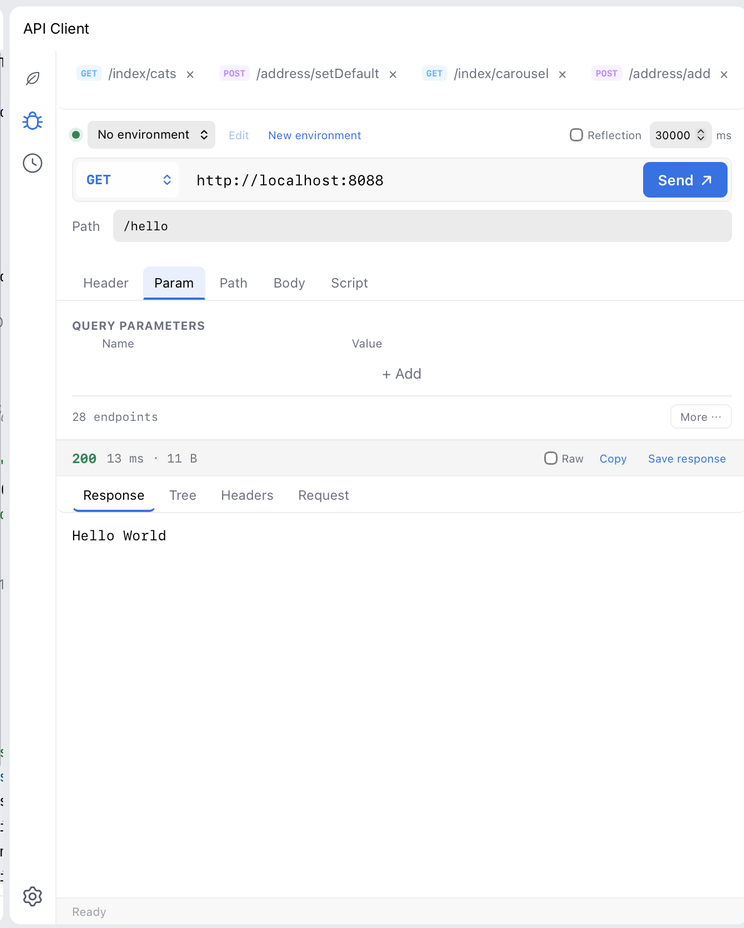

# Spring API Client for OpenIDEA

A tool window that lists the Spring Web mappings of the open project, builds a
request without writing a `.http` file first, sends it, and shows the response.
**Copy as cURL** and **Save as .http** export what you built, **Export OpenAPI**
writes an OpenAPI 3 document, environments resolve `{{variables}}`, and the last
requests stay in the history panel. The workbench now imports cURL, caches the
parameters and last response per endpoint, previews image/binary responses, saves
a text response, searches endpoints from a picker, saves requests into a flat
collection with batch execution, runs a sequential stress loop, and sends
multipart/form-data with project files. Requests have an adjustable timeout,
Set-Cookie values are kept in a per-host cookie jar and replayed automatically.
Environment files can also carry global query params, headers and form fields.
Static Spring Cloud Gateway routes from Java/Kotlin `route(...)` DSL or
`application.yml` are added as environments (route id + uri host). Each endpoint
opens in a request tab; tabs keep their own draft and last response. A WebSocket
panel connects, sends text and polls received frames.

Java/Kotlin methods also get a hover-revealed **Call this method** action at the
left edge of the editor, without adding permanent gutter icons. The action is
anchored to the method declaration, appears while the pointer is in the first
four editing-area columns of any line in the method body, and opens the same
Debug page as the runtime agent controls.

This is a clean-room plugin for the OpenIDEA plugin API. The host-side
`java-agent` / `java.agent` injection used by the runtime channel is a small
OpenIDEA extension; no GPL plugin code or assets are included. The plugin uses
plugin API 1.14 and declares both the `gutter-actions` and `hover-actions`
provider kinds.

## Runtime agent (host extension)

The plugin ships `agent/openidea-spring-agent.jar` and declares
`java-agent` plus the high-risk `java.agent` capability. An OpenIDEA host built
with the matching `java-agent` support injects:

```text
-javaagent:<plugin>/agent/openidea-spring-agent.jar
```

into Java Application / Spring Boot / Maven / Gradle run configurations at
launch, without project or JVM-argument changes. The agent currently proves
injection by writing:

- `~/.openidea/spring-api-client/runtime.json`
- `<working directory>/.openidea/spring-agent.json`

with its PID, random loopback port and token. A `SpringApplicationRunListener`
bundled in the agent jar captures the `ApplicationContext`; `/health` reports
`context:true` and `/mappings` returns the live `RequestMappingHandlerMapping`
entries. The API Client **Runtime** button reads the project runtime file and
shows the context state and runtime mapping count. **Reflection** in the request
footer sends the request to `/invoke`: the agent finds the runtime
`HandlerMethod`, resolves path/query/header/body arguments and invokes the
controller directly, bypassing servlet filters and interceptors. Servlet
request/response parameters and multipart reflection bodies are not supported.
The same agent exposes `/schedules` and `/triggerSchedule` (scan runtime
`@Scheduled` methods and invoke them) and `/routes` (runtime Gateway
`RouteDefinitionLocator` entries). The **Gateway** button lists the runtime `RouteDefinitionLocator` entries (id,
URI, predicates) in a panel. The **Schedules** button opens a picker and
triggers the selected method; the command **Spring API Client: Trigger Scheduled
Method** does the same from Find Action.

Runtime mappings are also shown as a **Runtime** group in the endpoint tree. Their
base URL uses the agent's `serverPort`/`contextPath` (the real application port),
so a runtime endpoint with no static source can still be selected and sent.

**Trace** enables ByteBuddy method advice on the application's loaded bean
classes (controller + `target/classes`/`build/classes` beans). Frames carry type,
method, duration, depth, thread and error; the agent keeps the newest 500. Trace
is off by default and is an explicit toggle; JDK/Spring/library classes are not
instrumented. SQL tracing, the Java script console and MCP tools are available
from the footer.

## UI

The tool window layout:

- a four-view left rail: **API list**, **Request / debug**, **History** and **Settings**;
- module → controller → API tree, with the project/module API counts, fully
  qualified controller names, controller Javadoc and endpoint Javadoc shown as
  comments; groups are collapsible, single-click jumps to the mapping's source,
  double-click opens the request workspace;
- top request tabs with method + path and closable tabs;
- environment bar, Reflection/timeout controls and a compact URL/path editor;
- Header / Param / Path / Body / Script request tabs;
- segmented body modes, JSON highlighting, response status/preview tabs;
- low-frequency actions (cURL, OpenAPI, Apifox, stress, WebSocket) and runtime
  tools behind a compact **More** menu;
- local settings for advanced tools, click navigation, parameter prompts, mock
  data, tab wrapping and API count.

Icons are adapted from the Apache-2.0 OpenIDEA EXPUI icon set, which follows the
JetBrains icon language.

This is an independent implementation for OpenIDEA. No GPL plugin code or assets
are copied into this Apache-2.0 plugin.



## Use

1. Install the folder as a linked plugin (already linked in this workspace), or
   use **Settings › Plugins › Install Plugin from Disk…** on this directory.
2. Open **Settings › Plugins**, enable **Spring API Client**, and grant:
   - `project.read` — scan Java/Kotlin controllers and read `application.*`.
   - `editor.read` — read the caret for **Select Endpoint at Caret**.
   - `project.write` — save requests under `.openidea/api-client/`.
   - `clipboard` — Copy as cURL.
   - `storage` — keep the request history (at most 30 entries).
   - `net:localhost`, `net:127.0.0.1` — local Spring Boot servers.
   - `net:ask` (optional) — HTTPS hosts and any other loopback host; the IDE
     asks once per host.
3. Open the **API Client** tool window on the right, or run
   **Spring API Client: Open** from Find Action.

Every Spring mapping gets a clickable **hummingbird icon** in the editor gutter
(plugin API `gutter-actions`). Clicking it reveals the API Client and selects that
endpoint; it does not generate a `.http` tab. The icon sits in the IDE's gutter
beside the line markers; its exact side relative to the IDE's own **API** icon is
the IDE's layout choice. The built-in **API** popup still generates its own
`.http` request and cannot be replaced by a plugin.

Every callable Java/Kotlin method gets a **Call this method** hover action
(plugin API `hover-actions`). Move the pointer into the first four columns of
the editing area on any line of the method body; the play button appears beside
the declaration line. Moving left into the gutter keeps it visible, while moving
right into the code hides it. The button never covers code text. The editor
context menu lists the actions whose line range contains the caret, so they are
also reachable from the keyboard.

If the hummingbird icon is not visible, check that the plugin is enabled and the
file is Java or Kotlin, then reopen the file. **Spring API Client: Select Endpoint
at Caret** remains available from Find Action and the editor context menu, and can
be bound to a shortcut in Settings › Keymap.

Pick an endpoint, fill the path parameters, edit query/header/body values, and
press **Send** (⌘/Ctrl+Enter also sends). Choose an **Environment** in the
footer to resolve `{{variables}}` from `http-client.env.json` /
`http-client.private.env.json`; **Copy as cURL** and **Send** use the resolved
values, **Save as .http** keeps the placeholders so the IDE's HTTP client can
reuse the environment. The **History** panel restores the last 30 requests, and
**Export OpenAPI** writes `.openidea/api-client/openapi.json` for the scanned
endpoints.

- **Apifox**: **Apifox** opens a small export panel with project ID and Bearer
  token. It posts the generated OpenAPI 3 document to
  `api.apifox.com/v1/projects/{id}/import-openapi` with
  `X-Apifox-Api-Version: 2024-03-28`; the token is not stored. HTTPS to
  `api.apifox.com` uses the `net:ask` permission (approve once).
- **MCP**: **MCP** in the footer shows the agent endpoint/token and runs a
  selected MCP tool with JSON arguments.
- **Script**: **Script** in the footer opens a Java editor; **Run** compiles and
  executes the body in the application JVM. `ScriptApi` exposes `getBean` and
  `context`.
- **SQL**: **SQL** in the footer starts/stops MyBatis logging and opens a panel
  with SQL text, parameter summary, duration and errors.
- **Trace**: **Trace** in the footer starts/stops tracing and opens a live panel
  (one-second polling) of completed method frames.
- **Schedules**: **Schedules** in the footer lists runtime `@Scheduled` methods
  and triggers the selected one through the agent.
- **Reflection**: enable it in the request footer to execute the selected
  controller method inside the running Spring Boot app instead of sending HTTP.
  The agent requires the `java.agent` permission and a ready runtime context.
- **WebSocket**: **WebSocket** in the footer opens a panel with URL, Connect,
  Close, Send and a log. It uses the plugin API's background WebSocket; the page
  drains messages every 300 ms. Text sending is supported; binary frames are
  shown base64-encoded. Headers from the active request are forwarded except the
  handshake-owned ones.
- **Tabs**: opening endpoints creates request tabs; each tab keeps its own
  draft and response. Click to switch, **×** to close. Tabs are persisted to
  plugin storage and restored on Reload; tabs can be dragged to reorder.
  Floating/split groups are not implemented.
- **Import cURL** in the request footer fills the method, server, path, query,
  headers and body of the selected endpoint, including `-F` multipart fields.
- **Search** opens a picker of every scanned endpoint; **Spring API Client: Search
  API** in Find Action does the same from anywhere.
- Sending stores the current parameters and the response in plugin storage; opening
  the endpoint again restores them and shows the cached response. Switching away
  without sending discards the edits, matching the request-tab behavior.
- Response **Tree** tab renders collapsible JSON objects/arrays with typed leaves.
- **Save response** writes JSON/XML/HTML/text under
  `.openidea/api-client/responses/`; image responses are previewed inline but are
  not saved yet because the sandbox only exposes text writes inside the project.
- **Collections**: save the current request into an optional folder; click an
  entry to restore it, double-click the name to rename, check entries and run
  only those (or all), with an iteration count (1–20). Each entry gets a status
  badge; **×** deletes it.
- **Stress** runs up to 200 requests one after another and reports ok/failed and
  average/min/max latency. The WASM sandbox has no threads, so this is a
  sequential load loop, not a parallel stress test.
- **Timeout** in the request footer sets the per-request timeout (default 30 s,
  clamped to 100 ms–300 s).
- **Cookies**: `Set-Cookie` responses are stored per host and sent as a `Cookie`
  header on later requests to that host unless the request already has one;
  **Clear cookies** empties the jar. Domain/path attributes are not modelled yet.
- **Spring Gateway**: route ids found in `RouteLocator` builder code or
  `spring.cloud.gateway.routes` become environments with the route `uri` as host.
  This is source/config discovery; running `RouteLocator` beans need a JVM agent.
- **Environment editor**: **Edit** opens the selected environment, **New** creates
  one. You can set the host and add global params/headers/form fields. Saved
  environments live in plugin storage and are merged with `http-client.env.json`;
  a stored environment overrides the file's globals for the same name. **Delete**
  removes the stored copy (a same-named file environment remains).
- Environment globals: a `$shared` or environment object can contain `params`,
  `headers` and `form` objects:
  ```json
  {
    "$shared": { "host": "http://localhost:8088" },
    "dev": {
      "params": { "debug": "true" },
      "headers": { "X-Env": "dev" },
      "form": { "app": "foodie" }
    }
  }
  ```
  They are merged into the current request when the environment is selected and
  removed when it changes.

Body type **Form data** sends `multipart/form-data`. Each row is Text or File; a
File row can pick a project file (absolute paths inside the project) and the plugin
reads the bytes through `project.read_bytes`. **Copy as cURL** emits `-F`; cURL
import understands `-F name=value`, `-F name=@path`, `;type=` and `;filename=`.

The server URL defaults to `http://localhost:<server.port><context-path>`. The
plugin reads the nearest module's `src/main/resources/application.properties` /
`.yml` / `.yaml` first, then the project root; `application-<profile>.*` wins when
`spring.profiles.active` is set. Without a configuration it falls back to
`http://localhost:8080`. In a multi-module project this matters: an empty
`application.yml` at the repository root does not hide the real port in
`<module>/src/main/resources/application.yml`.

## What it reads

- `@RestController` / `@Controller` classes and `@RequestMapping`,
  `@GetMapping`, `@PostMapping`, `@PutMapping`, `@DeleteMapping`,
  `@PatchMapping` (Java and common Kotlin layouts).
- Class- and method-level paths (including path arrays), `@RequestParam` names
  and defaults, `@RequestBody` types, `consumes`, `produces`, mapping `headers`.
- The body starts from the `@RequestBody` DTO's fields (Java/Kotlin), with a JSON
  formatter in the editor. Unresolvable DTOs start as `{}`.

## Limits

- Reflection, schedules, scripts, SQL tracing and method tracing need the Java
  agent and the `java.agent` permission; they are unavailable when the runtime
  context is not ready. Servlet request/response parameters and multipart
  reflection bodies are not supported.
- SSE streaming is not available through the current plugin host API (fetch is
  non-streaming); WebSocket is the supported streaming protocol. gRPC is not
  implemented; see [ROADMAP.md](ROADMAP.md).
- Apipost export is not wired yet; its Open API endpoint/token model differs from
  Apifox and needs a separate integration.
- Cookie attribute/path modelling and tab persistence are the next planned batch.
- Plain HTTP to a host other than localhost needs that host in the manifest as
  `net.http:<host>`; HTTPS and localhost use `net:ask` (approve once).
- Environment files are found at the module and project roots; PHP-style
  `application-dev.yml` profiles are not environment files.
- Dynamic variables such as `{{$uuid}}` are not generated yet; only environment
  values are substituted.
- Annotation parsing is pragmatic, not a compiler: unusual generated code,
  deeply nested controllers or exotic Kotlin signatures may not prefill.

## Plugin API

```toml
engines.openidea = "^1.14"
wasm = "dist/plugin.wasm"

[[contributes.providers]]
kinds = ["gutter-actions", "hover-actions"]
languages = ["java", "kotlin"]
```

- `gutter-actions`: the hummingbird endpoint marker per Spring mapping.
- `hover-actions`: the **Call this method** action. `line` is the method
  declaration, `start-line`/`end-line` cover the method body, and the command is
  `call-method`.
- The hover action is skipped for constructors and for methods the parser cannot
  identify as callable.

API 1.14 is currently delivered by the OpenIDEA PR branch
`feat/inline-editor-actions`; once the API is released, the plugin can depend on
the released SDK.

## Build

The checked-in `Cargo.toml` points at the OpenIDEA SDK checkout used for this
plugin. From a fresh clone, clone the API branch next to this repository:

```sh
git clone -b feat/inline-editor-actions \
  https://github.com/NeverKnowsTomorrow/openidea ../openidea-inline-actions
```

Then:

```sh
CARGO_HOME="$PWD/.cargo-home" cargo test
CARGO_HOME="$PWD/.cargo-home" cargo build --release --target wasm32-wasip2
cp target/wasm32-wasip2/release/openidea_spring_api_client.wasm dist/plugin.wasm

# build the Java agent if agent/src changed
./agent/build.sh

# validate and pack
../openidea-inline-actions/target/debug/openidea-plugin check .
(cd dist && ../../openidea-inline-actions/target/debug/openidea-plugin pack ..)
```

`openidea-plugin` is built from the IDE checkout with:

```sh
cargo build -p ide-host --bin openidea-plugin
```

The checked-in `dist/community.spring-api-client-0.50.0.oiplugin` is the
unsigned package for this source tree.

## License

Apache-2.0. See [LICENSE](LICENSE).
